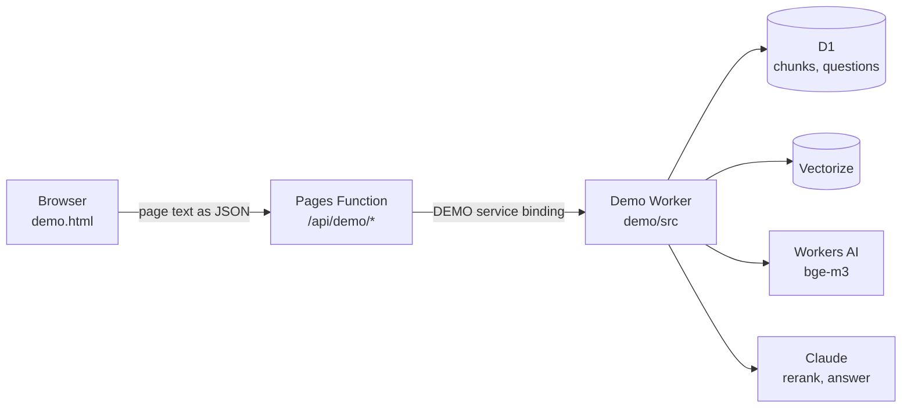

# The RAG pipeline behind joelstevick.com/demo

[joelstevick.com/demo](https://joelstevick.com/demo) lets a visitor upload their own PDFs and ask
up to ten questions. Each answer is two to four sentences citing the file and page it rests on, and
an answer whose citations don't check out is never shown. This repository is that demo's code,
from the page in the browser to the Worker that answers, plus the eval harness used to tune it.

It runs on Cloudflare: a Pages site (the page and its functions), a private Worker (the pipeline),
D1 (SQLite) for chunks and questions, Vectorize for the vectors, Workers AI for embeddings
(bge-m3), and Claude through the Anthropic API for reranking and answering.



## Trace a request, from the browser inward

Read the files in this order; the line links land on the step.

### 1. The page: `demo.html`

- `GET /demo` is the static [demo.html](demo.html). Its script ([line 101](demo.html#L101)) does
  the browser's part.
- On load it asks `GET /api/demo/session` for the demo's files and questions left
  ([line 162](demo.html#L162)).
- **The PDFs never leave the browser.** Picking files fires the change handler
  ([line 198](demo.html#L198)); `pagesOf` ([line 184](demo.html#L184)) reads each PDF with pdf.js and
  extracts each page's text. Only that text and the file name are posted, one file at a time, to
  `POST /api/demo/files` ([line 207](demo.html#L207)).
- Removing a file sends `DELETE /api/demo/files` ([line 141](demo.html#L141)); asking sends
  `POST /api/demo/ask` ([line 288](demo.html#L288)).

### 2. The Pages Functions: `functions/`

Cloudflare Pages routes by file name: `functions/demo.ts` serves `/demo`, and
`functions/api/demo/[[path]].ts` is a catch-all for every path under `/api/demo/`.

- [functions/demo.ts](functions/demo.ts#L10): `GET /demo?key=…` (a bookmarked link) sets the demo
  cookie, then serves the page. Without a key it serves the page unchanged.
- [functions/api/demo/[[path]].ts](functions/api/demo/[[path]].ts#L22): the proxy. It allows only
  `session`, `files` and `ask`, reads the visitor's demo key from the cookie
  ([functions/_lib/demo.ts](functions/_lib/demo.ts#L11)), and forwards the request to the Worker as
  `X-Demo-Key` through the `DEMO` service binding ([line 31](functions/api/demo/[[path]].ts#L31)).
  The Worker has no public URL; this binding is the only way in.
- [functions/_lib/track.ts](functions/_lib/track.ts) is a stand-in here: on the site it is the
  visitor analytics and consent check, which are not part of this repository.

### 3. The Worker's entry: `demo/src/index.ts` and `app.ts`

- [demo/wrangler.toml](demo/wrangler.toml) names the entry (`main = "src/index.ts"`) and the
  bindings the runtime injects into `env`: `DB` (D1), `VECTORS` (Vectorize), `AI` (Workers AI).
  `ANTHROPIC_API_KEY` is a Worker secret.
- [demo/src/index.ts](demo/src/index.ts#L10) builds the Worker with `createApp`, passing a function
  that turns `env` into the models. The tests pass scripted models through the same door
  ([tests/support/scripted.ts](tests/support/scripted.ts)), so no test calls a paid API.
- [`createApp`](demo/src/app.ts#L574) returns `{ fetch, scheduled }`. `fetch` calls
  [`route`](demo/src/app.ts#L552), which looks the demo up by the key's SHA-256
  ([`signedIn`](demo/src/app.ts#L82)) and dispatches to `session`, `upload`, `remove` or `ask`.
  `scheduled` runs daily: [`purge`](demo/src/app.ts#L408) deletes a demo's documents after 10 days
  without use.

### 4. Ingest: `upload` in `app.ts`

Search the file for `INGEST` to see each stage.

| Stage | Where | What |
|---|---|---|
| 1 | [app.ts:146](demo/src/app.ts#L146) | validate the name, page count and each page's text |
| 2 | [app.ts:161](demo/src/app.ts#L161) | claim the file name (one row per file) |
| 3 | [app.ts:173](demo/src/app.ts#L173) | check the demo's limits in one atomic statement |
| 4 | [app.ts:190](demo/src/app.ts#L190) | chunk each page: [chunks.ts](demo/src/chunks.ts#L18), about 900 characters, cut at a sentence end |
| 5 | [app.ts:196](demo/src/app.ts#L196) | store the chunks in D1, rolled back on failure |
| 6 | [app.ts:223](demo/src/app.ts#L223) | embed the chunks (bge-m3) and upsert the vectors into Vectorize, under the demo's id as namespace |
| 7 | [app.ts:238](demo/src/app.ts#L238) | notify on a demo's first upload, and reply |

If embedding fails, the file is still searchable by keywords; nothing the visitor sees depends on it.

### 5. Ask: `ask` in `app.ts`

Search the file for `ASK` to see each stage.

| Stage | Where | What |
|---|---|---|
| 1 | [app.ts:336](demo/src/app.ts#L336) | validate the question |
| 2 | [app.ts:340](demo/src/app.ts#L340) | reserve one of the ten questions, atomically |
| 3-4 | [app.ts:360](demo/src/app.ts#L360) | [`retrieval`](demo/src/app.ts#L311): read every chunk from D1, embed the question and query Vectorize, then [`fuseKeywordAndVector`](demo/src/retrieval.ts#L101) runs BM25 and merges both rankings by reciprocal rank fusion |
| 5 | [app.ts:372](demo/src/app.ts#L372) | [`rerank`](demo/src/models.ts#L116): Claude Haiku orders the 48-chunk pool; then [`widen`](demo/src/widen.ts#L27) adds each chosen chunk's neighbours under a character budget |
| 6 | [app.ts:379](demo/src/app.ts#L379) | [`answer`](demo/src/models.ts#L159): Claude Sonnet answers from those passages only, citing their ids |
| 7 | [app.ts:389](demo/src/app.ts#L389) | [`checkAnswer`](demo/src/check.ts#L96): code checks every cited id was given and every figure appears in a cited passage; otherwise the answer is refused and the fallback is shown |
| 8 | [app.ts:393](demo/src/app.ts#L393) | return the answer with each source's stored text, never the model's paraphrase |

Retrieval is split on purpose: everything that reaches a service and can fail (D1, the embedding
model, Vectorize) is in `retrieval`, with its fallbacks, so `fuseKeywordAndVector` stays a pure function of
plain values that can be tested with arrays alone.

## The eval harness: `evals/`

[evals/README.md](evals/README.md) covers running and reading it; [evals/JOURNAL.md](evals/JOURNAL.md)
is how the runs were used to tune the pipeline.

- [evals/run.mjs](evals/run.mjs) starts the Worker locally under `wrangler dev`, uploads the corpus
  through `POST /api/files` exactly as the page extracts it, asks each case in
  [evals/cases.jsonl](evals/cases.jsonl) through `POST /api/ask`, and scores it: required facts in
  the answer, and whether each expected source reached the pool, the context and the citations. A
  miss names the stage that lost it.
- [evals/worker.ts](evals/worker.ts) is the same `createApp` with the real models, plus `/eval/*`
  routes for the runner. It traces every Anthropic call by wrapping `fetch`.
- Spend is capped in `run.mjs`. Each run's results are in [evals/runs/](evals/runs/).
- The corpus in [evals/corpus/](evals/corpus/) is not MIT licensed (see [LICENSE](LICENSE)). The
  résumé has some personal details redacted, in the PDF and in the run results that quote it.

## Run it

```sh
npm install
npm run typecheck
npm test          # the Worker's routes in workerd against a local D1, with scripted models
npm run eval      # real models: needs evals/.dev.vars with ANTHROPIC_API_KEY, and wrangler login
```

To deploy your own copy, create the D1 database, the Vectorize index (1,024 dimensions, cosine)
and the secret, put their names in `demo/wrangler.toml`, and drop the `MAILER` binding (it notifies
the site's owner of a demo's first upload). The page loads the site's stylesheet and scripts, which
are not included.

## License

MIT, © 2026 Joel Stevick, except `evals/corpus/` (see [LICENSE](LICENSE)).
