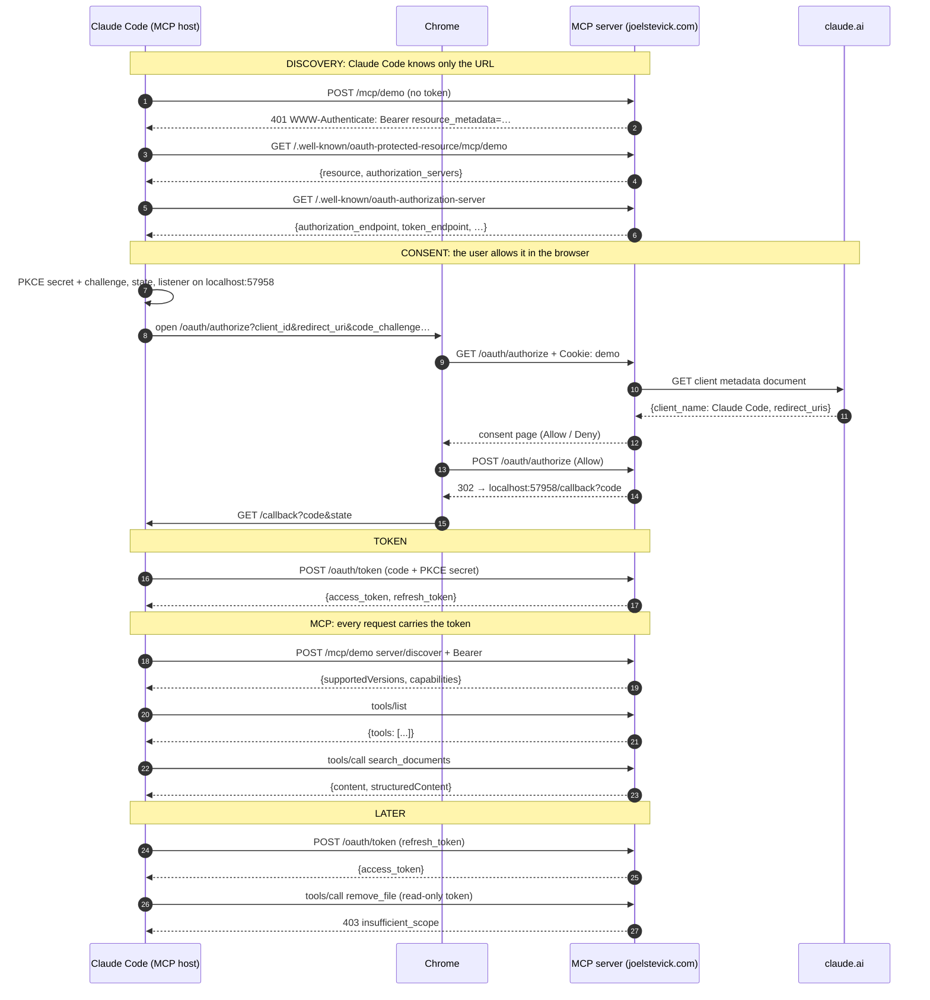

# How Claude Code gets into the demo's MCP server: every step over the wire

Three parties, plus one: the **MCP host** (Claude Code, also the MCP client), **Chrome** (the user), the **MCP server** (`https://joelstevick.com/mcp/demo`: the site forwards to the demo Worker, where Cloudflare's OAuth library and our MCP server run), and **claude.ai**, which hosts Claude Code's client description. Each numbered arrow has a footnote below: why it happens, what crosses the wire, and the code that handles it. Values are real (captured 2026-11-22); secrets are `…`. Open the preview (Cmd+Shift+V) to see the diagram.



## 1. Claude Code tries the server, with no token

**Claude Code → MCP server.** `claude mcp add` stored only a name and the URL, so Claude Code doesn't know yet that the server needs authorization. It just sends its first MCP message. The site receives it at `/mcp/demo` (the file `functions/mcp/demo.ts` is that route) and forwards it, unchanged except for a few headers, to the demo Worker.

**On the wire:**

```http
POST https://joelstevick.com/mcp/demo
Content-Type: application/json
Accept: application/json, text/event-stream
MCP-Protocol-Version: 2026-07-28
Mcp-Method: server/discover

{"jsonrpc": "2.0", "id": "server-discover-probe-1", "method": "server/discover",
 "params": {"_meta": {"io.modelcontextprotocol/protocolVersion": "2026-07-28", ...}}}
```

**The code:** The site's forwarder: copy the request, drop headers a caller must not set, send it over the `DEMO` binding.

[functions/_lib/demo-mcp.ts:28-44](../functions/_lib/demo-mcp.ts#L28-L44)

```ts
export async function forwardToDemo(request: Request, env: DemoMcpEnv, consent = false): Promise<Response> {
  if (env.DEMO === undefined) return Response.json({ error: "The demo is not available right now." }, { status: 503 });
  const headers = new Headers(request.headers);
  const names: string[] = [];
  headers.forEach((_value, name) => names.push(name));
  for (const name of names) if (name.toLowerCase().startsWith("x-demo-") || name.toLowerCase() === "x-client-address") headers.delete(name);
  if (!consent) headers.delete("Cookie");
  headers.set("X-Client-Address", request.headers.get("CF-Connecting-IP") ?? "unknown");
  headers.set("X-Demo-Keep", mayRecord(request, env) ? "1" : "0");
  const key = consent ? demoKey(request) : null;
  if (key !== null) headers.set("X-Demo-Key", key);
  const answer = await env.DEMO.fetch(request.url, {
    method: request.method,
    headers,
    body: request.method === "GET" || request.method === "HEAD" ? undefined : await request.arrayBuffer(),
    redirect: "manual",
  });
```


## 2. The server answers 401: get a token, and here is where to learn how

**MCP server → Claude Code.** In the Worker, `/mcp/demo` goes to the OAuth library's resource server. There is no `Authorization` header, so the library answers 401 with a `WWW-Authenticate: Bearer` header. Under the MCP spec that header is the client's signal to start OAuth: `resource_metadata` says where to read next, `scope` what to ask for first (our `requiredScopes`).

**On the wire:**

```http
HTTP/1.1 401 Unauthorized
WWW-Authenticate: Bearer realm="OAuth",
  resource_metadata="https://joelstevick.com/.well-known/oauth-protected-resource/mcp/demo",
  scope="docs:read"
```

**The code:** The routing in the Worker (our code), then the resource server's settings the 401 is built from:

[demo/src/oauth.ts:114-121](../demo/src/oauth.ts#L114-L121)

```ts
  if (pathname === '/mcp/demo' || pathname.startsWith('/mcp/demo/') || pathname.startsWith('/.well-known/oauth-protected-resource')) {
    // Every request is counted by address before its token is looked at, so a junk Authorization header
    // cannot skip the limit; a request with a valid token is also limited per demo (mcp.ts).
    if (!(await anonymousAllowed(request, env))) return tooMany()
    const scoped = { ...env }
    runs.set(scoped, { models, options, ctx })
    return resource.fetch(request, scoped, context)
  }
```

[demo/src/oauth.ts:71-75](../demo/src/oauth.ts#L71-L75)

```ts
  const resource = new OAuthResourceServer<Env, Props>({
    resourceMetadata: { resource: resourceUrl, authorization_servers: [origin], bearer_methods_supported: ['header'], resource_name: 'Your demo documents' },
    // What any access needs, and so what a client asks for first; removing a file is asked for when it is needed.
    requiredScopes: [READ],
    validateToken: (env) => (wanted, token) => authorization.validateToken<Props>(wanted, token, env),
```


## 3. Claude Code reads the server's metadata

**Claude Code → MCP server.** It follows `resource_metadata` from step 2. A Pages function file can't live under `/.well-known/`, so the site's middleware forwards both discovery paths to the Worker.

**On the wire:**

```http
GET https://joelstevick.com/.well-known/oauth-protected-resource/mcp/demo
```

**The code:**
[functions/_middleware.ts:10-12](../functions/_middleware.ts#L10-L12)

```ts
export const onRequest: PagesFunction<DemoMcpEnv> = async ({ request, next, env }) => {
  const url = new URL(request.url);
  if (WELL_KNOWN.some((prefix) => url.pathname === prefix || url.pathname.startsWith(`${prefix}/`))) return forwardToDemo(request, env);
```


## 4. The server's metadata: which authorization server issues its tokens

**MCP server → Claude Code.** Built by the library from our `resourceMetadata` on each request. `resource` is the audience every token must be for; `authorization_servers` is who issues them (here the same site; it could be Okta or Entra ID).

**On the wire:**

```json
200 OK
{
  "resource": "https://joelstevick.com/mcp/demo",
  "authorization_servers": ["https://joelstevick.com"],
  "scopes_supported": ["docs:read"],
  "bearer_methods_supported": ["header"],
  "resource_name": "Your demo documents"
}
```

**The code:**
[demo/src/oauth.ts:71-74](../demo/src/oauth.ts#L71-L74)

```ts
  const resource = new OAuthResourceServer<Env, Props>({
    resourceMetadata: { resource: resourceUrl, authorization_servers: [origin], bearer_methods_supported: ['header'], resource_name: 'Your demo documents' },
    // What any access needs, and so what a client asks for first; removing a file is asked for when it is needed.
    requiredScopes: [READ],
```


## 5. Claude Code reads the authorization server's metadata

**Claude Code → MCP server.** Now it knows the issuer, `https://joelstevick.com`, and reads the issuer's standard metadata at a fixed path under it (RFC 8414). In the Worker, anything that isn't the consent page or the MCP endpoint goes to the library's authorization server.

**On the wire:**

```http
GET https://joelstevick.com/.well-known/oauth-authorization-server
```

**The code:**
[demo/src/oauth.ts:122-124](../demo/src/oauth.ts#L122-L124)

```ts
  // Registration and the token endpoint are open to anyone.
  if (request.method === 'POST' && !(await anonymousAllowed(request, env))) return tooMany()
  return authorization.fetch(request, env, context)
```


## 6. The authorization server's metadata: its endpoints and rules

**MCP server → Claude Code.** This is how Claude Code knows **which page to open in the browser** (`authorization_endpoint`), where to trade the code (`token_endpoint`), to use PKCE with SHA-256, and that it may use a URL as its client id (`client_id_metadata_document_supported`). The library builds it from our settings.

**On the wire:**

```json
200 OK
{
  "issuer": "https://joelstevick.com",
  "authorization_endpoint": "https://joelstevick.com/oauth/authorize",
  "token_endpoint": "https://joelstevick.com/oauth/token",
  "registration_endpoint": "https://joelstevick.com/oauth/register",
  "scopes_supported": ["docs:read", "docs:write", "offline_access"],
  "response_types_supported": ["code"],
  "grant_types_supported": ["authorization_code", "refresh_token"],
  "code_challenge_methods_supported": ["S256"],
  "authorization_response_iss_parameter_supported": true,
  "client_id_metadata_document_supported": true
}
```

**The code:**
[demo/src/oauth.ts:61-70](../demo/src/oauth.ts#L61-L70)

```ts
  const authorization = new OAuthAuthorizationServer<Env>({
    issuer: origin,
    resources: [resourceUrl],
    authorizeEndpoint: '/oauth/authorize',
    tokenEndpoint: '/oauth/token',
    // Dynamic registration, for a client with no metadata document of its own; open to anyone, so limited by address.
    clientRegistrationEndpoint: '/oauth/register',
    clientIdMetadataDocumentEnabled: true,
    scopesSupported: [READ, WRITE, OFFLINE],
  })
```


## 7. Claude Code gets ready: PKCE secret, state, a local listener

**Claude Code → Claude Code.** Nothing on the wire. It makes a random secret (the PKCE verifier) and sends only its SHA-256 hash later, so a stolen code is useless without the secret. It makes a random `state` to match the redirect to this attempt. It starts a tiny web server on `localhost:57958` to receive the browser's redirect. Claude Code's own code isn't in this repo; our test client does exactly the same:

**On the wire:**

```
(nothing sent)
```

**The code:**
[demo/tests/mcp-support.ts:108-109](../demo/tests/mcp-support.ts#L108-L109)

```ts
  const verifier = b64url(crypto.getRandomValues(new Uint8Array(32)))
  const challenge = b64url(await crypto.subtle.digest('SHA-256', new TextEncoder().encode(verifier)))
```


## 8. Claude Code opens the browser at the consent URL

**Claude Code → Chrome.** The user must allow access **on the authorization server's own page**, never inside the client, so it opens the system browser at `authorization_endpoint` from step 6, with what it learned: its client id, the redirect to its listener, the scope from step 2 plus `offline_access` (for a refresh token), the PKCE challenge, and the `resource` from step 4.

**On the wire:**

```
https://joelstevick.com/oauth/authorize
  ?response_type=code
  &client_id=https://claude.ai/oauth/claude-code-client-metadata
  &redirect_uri=http://localhost:57958/callback
  &scope=docs:read offline_access
  &state=_NTN8JTq…
  &code_challenge=x-PBvXlF…
  &code_challenge_method=S256
  &prompt=consent
  &resource=https://joelstevick.com/mcp/demo
```

**The code:** Our test client builds the same URL:

[demo/tests/mcp-support.ts:110-114](../demo/tests/mcp-support.ts#L110-L114)

```ts
  const url = new URL(found.server.authorization_endpoint)
  for (const [name, value] of Object.entries({
    response_type: 'code', client_id: registered.client_id, redirect_uri: REDIRECT, scope: options.scope ?? 'docs:read docs:write offline_access',
    state: 'st-1', code_challenge: challenge, code_challenge_method: 'S256', resource: found.resource.resource, ...options.query,
  })) url.searchParams.set(name, value)
```


## 9. Chrome asks for the consent page, sending the demo cookie

**Chrome → MCP server.** Chrome holds the site's own `demo` cookie from the emailed sign-in link. Only on `/oauth/authorize` does the site pass cookies through, and it turns the demo cookie into an internal `X-Demo-Key` header: that is how the Worker knows **which demo** (which user) is being asked.

**On the wire:**

```http
GET https://joelstevick.com/oauth/authorize?response_type=code&client_id=…
Cookie: demo=…
```

**The code:**
[functions/_lib/demo-mcp.ts:34-38](../functions/_lib/demo-mcp.ts#L34-L38)

```ts
  if (!consent) headers.delete("Cookie");
  headers.set("X-Client-Address", request.headers.get("CF-Connecting-IP") ?? "unknown");
  headers.set("X-Demo-Keep", mayRecord(request, env) ? "1" : "0");
  const key = consent ? demoKey(request) : null;
  if (key !== null) headers.set("X-Demo-Key", key);
```

[demo/src/oauth.ts:109-113](../demo/src/oauth.ts#L109-L113)

```ts
  // The consent page can make the Worker fetch a client's metadata document, so it is limited by address too.
  if (pathname === '/oauth/authorize') {
    if (!(await anonymousAllowed(request, env))) return tooMany()
    return authorize(request, env, api(env, origin))
  }
```


## 10. The server fetches the app's client metadata document

**MCP server → claude.ai.** The `client_id` is a URL, so the library fetches it to learn the app's name and the redirect addresses it may use, and checks the request's `redirect_uri` against them. Our code calls the library's `parseAuthRequest` and `describeConsent`, then looks up the demo from the cookie.

**On the wire:**

```http
GET https://claude.ai/oauth/claude-code-client-metadata
```

**The code:**
[demo/src/oauth.ts:201-206](../demo/src/oauth.ts#L201-L206)

```ts
    if (request.method === 'GET') {
      // The library checks the client, its redirect address, the resource and PKCE before anything is shown.
      const asked = await oauth.parseAuthRequest(request)
      const demo = await signedIn(request, env)
      if (demo === null) return needDemo()
      const details = await oauth.describeConsent(asked)
```


## 11. claude.ai returns Claude Code's metadata

**claude.ai → MCP server.** `client_name` and the domain go on the consent page ("Published by claude.ai"). `token_endpoint_auth_method: none` means a public client with no secret, which is why PKCE matters.

**On the wire:**

```json
{
  "client_id": "https://claude.ai/oauth/claude-code-client-metadata",
  "client_name": "Claude Code",
  "client_uri": "https://claude.ai",
  "redirect_uris": ["http://localhost/callback", "http://127.0.0.1/callback"],
  "grant_types": ["authorization_code", "refresh_token"],
  "response_types": ["code"],
  "token_endpoint_auth_method": "none"
}
```

**The code:** (the library's; nothing of ours)

## 12. The server shows the consent page

**MCP server → Chrome.** Our page: the app's name, who published it, where the access goes, and the permissions as checkboxes (read always, remove a file unticked). `beginConsent` adds a one-use hidden handle and a short-lived cookie so only this browser can submit it.

**On the wire:**

```html
200 OK  text/html
Set-Cookie: __Host-oauth-consent-…=…; HttpOnly; Secure
<h1>Allow Claude Code to use your demo's documents?</h1>
Published by claude.ai. The access will be sent to localhost.
☑ Search, ask and read your uploaded documents
☐ Remove a file from your demo
[Allow] [Deny]
```

**The code:**
[demo/src/oauth.ts:212-213](../demo/src/oauth.ts#L212-L213)

```ts
      const consent = await oauth.beginConsent(asked)
      return page(`Allow ${details.clientName || 'an app'}`, consentPage(details, consent.handle), 200, consent.headers)
```

[demo/src/oauth.ts:168-184](../demo/src/oauth.ts#L168-L184)

```ts
function consentPage(details: ConsentDescription, handle: string): string {
  const name = escape(details.clientName || 'An app')
  const who = details.clientDomain
    ? `Published by <strong>${escape(details.clientDomain)}</strong>.`
    : 'This app registered itself, so its name is not verified.'
  return `<h1>Allow ${name} to use your demo&#39;s documents?</h1>
<p>${who} The access will be sent to <strong>${escape(details.redirectHost)}</strong>.</p>
${details.redirectIsLoopback ? '<p class="warn"><strong>This sends access to an app on your computer.</strong> Continue only if you just started connecting from it.</p>' : ''}
<form method="post">
  <input type="hidden" name="handle" value="${escape(handle)}">
  ${details.scope.includes(OFFLINE) ? '<input type="hidden" name="offline" value="1">' : ''}
  <label><input type="checkbox" checked disabled> ${escape(SCOPE_WORDS[READ])}</label>
  <label><input type="checkbox" name="scope" value="${WRITE}"> ${escape(SCOPE_WORDS[WRITE])}</label>
  <p>You can disconnect it at any time on your <a href="/demo">demo page</a>.</p>
  <p class="buttons"><button name="decision" value="approve">Allow</button> <button name="decision" value="deny">Deny</button></p>
</form>`
}
```


## 13. The user clicks Allow

**Chrome → MCP server.** The form posts back with the handle and the boxes ticked. What is granted is what was ticked, never what the app asked for.

**On the wire:**

```http
POST https://joelstevick.com/oauth/authorize
Cookie: demo=…; __Host-oauth-consent-…=…
Content-Type: application/x-www-form-urlencoded

handle=…&decision=approve&offline=1
```

**The code:**
[demo/src/oauth.ts:215-226](../demo/src/oauth.ts#L215-L226)

```ts
    if (request.method !== 'POST') return json(405, { error: 'method not allowed' })
    const demo = await signedIn(request, env)
    if (demo === null) return needDemo()
    const form = await request.formData()
    const handle = String(form.get('handle') ?? '')
    if (form.get('decision') !== 'approve') {
      const denied = await oauth.denyConsent(request, handle)
      return new Response(null, { status: 302, headers: decided(denied.headers, demo, 'denied', []) })
    }
    // What is granted is what the visitor ticked: reading always, removing only with its box, a refresh token when the client asked.
    const scope = [READ, ...(form.getAll('scope').includes(WRITE) ? [WRITE] : []), ...(form.get('offline') === '1' ? [OFFLINE] : [])]
    const approved = await oauth.approveConsent(request, handle, { scope })
```


## 14. The server stores the grant and redirects with a one-time code

**MCP server → Chrome.** `completeAuthorization` stores a **grant** in KV: its user is the demo, its scopes are the ticked ones, and its private `props` hold `{ demo: id }`. Every token issued later points to this grant. It returns the redirect to the app's listener with a short-lived code.

**On the wire:**

```http
302 Found
Location: http://localhost:57958/callback?code=…&state=_NTN8JTq…&iss=https://joelstevick.com
```

**The code:**
[demo/src/oauth.ts:232-242](../demo/src/oauth.ts#L232-L242)

```ts
    const details = await oauth.describeConsent(approved.request)
    const { redirectTo } = await oauth.completeAuthorization({
      request: approved.request,
      // The grant's user is the demo, so its grants can be listed and revoked by demo.
      userId: demo.id,
      metadata: { name: details.clientName, domain: details.clientDomain ?? null, host: details.redirectHost },
      scope: approved.request.scope,
      props: { demo: demo.id } satisfies Props,
    })
    approved.headers.set('Location', redirectTo)
    return new Response(null, { status: 302, headers: decided(approved.headers, demo, 'allowed', approved.request.scope) })
```


## 15. Chrome follows the redirect to Claude Code's listener

**Chrome → Claude Code.** The listener from step 7 receives the code. Claude Code checks `state` matches step 7 and `iss` matches step 6's issuer. The code is useless to anyone without the PKCE secret.

**On the wire:**

```http
GET http://localhost:57958/callback?code=…&state=…&iss=https://joelstevick.com
```

**The code:** (Claude Code's own code)

## 16. Claude Code trades the code for tokens

**Claude Code → MCP server.** It posts the code with the PKCE secret to `token_endpoint` from step 6. The library checks the code is unused and unexpired, and that SHA-256 of the secret equals the challenge from step 8. Our test client sends the same request:

**On the wire:**

```http
POST https://joelstevick.com/oauth/token
Content-Type: application/x-www-form-urlencoded

grant_type=authorization_code&code=…&redirect_uri=http://localhost:57958/callback
&client_id=https://claude.ai/oauth/claude-code-client-metadata&code_verifier=…
&resource=https://joelstevick.com/mcp/demo
```

**The code:**
[demo/tests/mcp-support.ts:133-139](../demo/tests/mcp-support.ts#L133-L139)

```ts
export async function exchange(w: World, shown: Consent, code: string): Promise<Response> {
  return site(w, shown.tokenEndpoint, {
    method: 'POST',
    headers: { 'Content-Type': 'application/x-www-form-urlencoded' },
    body: new URLSearchParams({ grant_type: 'authorization_code', code, redirect_uri: REDIRECT, client_id: shown.clientId, code_verifier: shown.verifier, resource: MCP }).toString(),
  })
}
```


## 17. The server returns the tokens

**MCP server → Claude Code.** An access token for one hour and a refresh token, stored on the server only as hashes. `scope` is what was actually granted. Claude Code saves them and shows the server as Connected. This endpoint is entirely the library's (`tokenEndpoint` in step 6's settings).

**On the wire:**

```json
200 OK
{
  "access_token": "…",
  "token_type": "bearer",
  "expires_in": 3600,
  "refresh_token": "…",
  "scope": "docs:read offline_access"
}
```

**The code:** (the library's)

## 18. Claude Code retries its first MCP message, now with the token

**Claude Code → MCP server.** The same `server/discover` as step 1, now with `Authorization: Bearer`. The library validates the token (exists, unexpired, issued for `/mcp/demo`), finds its grant, and calls our handler with the grant's `props.demo`: that is **which demo** this request may touch.

**On the wire:**

```http
POST https://joelstevick.com/mcp/demo
Authorization: Bearer …
MCP-Protocol-Version: 2026-07-28
Mcp-Method: server/discover

{"jsonrpc": "2.0", "id": "server-discover-probe-1", "method": "server/discover", "params": {"_meta": {...}}}
```

**The code:**
[demo/src/oauth.ts:75-88](../demo/src/oauth.ts#L75-L88)

```ts
    validateToken: (env) => (wanted, token) => authorization.validateToken<Props>(wanted, token, env),
    handler: {
      fetch(request, env, ctx) {
        const run = runs.get(env)
        if (run === undefined) return json(500, { error: 'Something went wrong. Please try again in a minute.' })
        return serveMcp(request, env, run, ctx.props.demo, {
          token: ctx.auth.token,
          scopes: ctx.auth.scope,
          clientId: ctx.auth.clientId,
          expiresAt: ctx.auth.expiresAt,
          resource: resourceUrl,
          resourceMetadataUrl: `${origin}/.well-known/oauth-protected-resource/mcp/demo`,
        })
      },
```


## 19. The server says what it supports

**MCP server → Claude Code.** `serveMcp` loads the demo, counts its limits, and hands the request to the official SDK, which answers `server/discover` from the server our `build` registered.

**On the wire:**

```json
200 OK
{"jsonrpc": "2.0", "id": "server-discover-probe-1", "result": {
  "supportedVersions": ["2026-07-28"],
  "capabilities": {"tools": {"listChanged": true}, "resources": {"listChanged": true}, "prompts": {"listChanged": true}},
  "instructions": "This server searches, answers from and reads the PDFs one person uploaded…",
  "_meta": {"io.modelcontextprotocol/serverInfo": {"name": "joelstevick-demo-documents", "version": "1.0.0"}}}}
```

**The code:**
[demo/src/mcp.ts:398-416](../demo/src/mcp.ts#L398-L416)

```ts
export async function serveMcp(request: Request, env: Env, run: Run, demoId: string, caller: Caller): Promise<Response> {
  const demo = await env.DB.prepare('SELECT id, asks_used, files, pages, chars, company, contact, cleared_at FROM demos WHERE id = ? AND purged_at IS NULL')
    .bind(demoId).first<Demo>()
  // A token for a demo that is gone is no longer good.
  if (demo === null) return json(401, { error: 'invalid_token' }, { 'WWW-Authenticate': 'Bearer error="invalid_token"' })
  if (!(await hit(env, `demo:${demo.id}`, minute(), PER_MINUTE))) return tooMany()
  // A call counts as use of the demo, so one used only from an MCP host is not purged as idle.
  await env.DB.prepare("UPDATE demos SET used_at = datetime('now') WHERE id = ?").bind(demo.id).run()
  const handler = createMcpHandler(() => build(env, run, demo, request.headers.get('X-Demo-Keep') === '1' ? '1' : '0'), { maxRequestBodySize: MAX_BODY })
  return handler.fetch(request, {
    authInfo: {
      token: caller.token,
      clientId: caller.clientId ?? '',
      scopes: caller.scopes,
      expiresAt: caller.expiresAt,
      resource: new URL(caller.resource),
      resourceMetadataUrl: caller.resourceMetadataUrl,
    },
  })
```


## 20. Claude Code asks for the tools

**Claude Code → MCP server.** Its model needs to know what it can call.

**On the wire:**

```http
POST /mcp/demo   Authorization: Bearer …
{"jsonrpc": "2.0", "id": 2, "method": "tools/list", "params": {"_meta": {...}}}
```

**The code:** (answered by the SDK from what `build` registered)

## 21. The server lists its tools

**MCP server → Claude Code.** Each tool's description is what the model reads to decide when to use it; the schemas say what to send and what comes back; the annotations tell the host which tool only reads.

**On the wire:**

```json
{"jsonrpc": "2.0", "id": 2, "result": {"tools": [
  {"name": "search_documents", "title": "Search your documents",
   "description": "Finds the passages of the uploaded PDFs that best match a query…",
   "inputSchema": {"type": "object", "properties": {"query": {"type": "string"}, "limit": {...}, "cursor": {...}}, "required": ["query"]},
   "outputSchema": {...}, "annotations": {"readOnlyHint": true}},
  {"name": "ask_documents", ...}, {"name": "remove_file", ...}]}}
```

**The code:**
[demo/src/mcp.ts:207-219](../demo/src/mcp.ts#L207-L219)

```ts
  server.registerTool('search_documents', {
    title: 'Search your documents',
    description: 'Finds the passages of the uploaded PDFs that best match a query, by meaning and by keyword. Returns each passage with its file and page. Use it to read what the documents say; it writes no answer and spends no question.',
    inputSchema: {
      query: z.string().min(1).max(500).describe('What to look for, in plain words.'),
      limit: z.number().int().min(1).max(MAX_PASSAGES).optional().describe(`How many passages to return (default ${DEFAULT_PASSAGES}, at most ${MAX_PASSAGES}).`),
      cursor: z.string().optional().describe('The nextCursor of an earlier call with the same query, for the passages after it.'),
    },
    outputSchema: {
      passages: z.array(z.object({ file: z.string(), page: z.number(), text: z.string(), uri: z.string() })),
      nextCursor: z.string().optional(),
    },
    annotations: { readOnlyHint: true, openWorldHint: false },
```


## 22. The model decides to search: tools/call

**Claude Code → MCP server.** Claude Code sends the tool's name and the arguments its model chose.

**On the wire:**

```http
POST /mcp/demo   Authorization: Bearer …   Mcp-Method: tools/call   Mcp-Name: search_documents
{"jsonrpc": "2.0", "id": 3, "method": "tools/call",
 "params": {"name": "search_documents", "arguments": {"query": "Zonar", "limit": 1}}}
```

**The code:** (the SDK validates the arguments against `inputSchema`, then calls our handler, step 23)

## 23. The server runs the search and returns passages

**MCP server → Claude Code.** Our handler runs the demo's own retrieval for **this demo only** and returns each passage labelled with its file and page, a link to the page, and the same data typed in `structuredContent` (which Claude Code shows).

**On the wire:**

```json
{"jsonrpc": "2.0", "id": 3, "result": {
  "content": [
    {"type": "text", "text": "[Joel_Stevick_Resume_BDR.pdf, page 2]\n…Team Lead - EVIR Web… Zonar Systems…"},
    {"type": "resource_link", "uri": "demo://files/3/pages/2", "name": "Joel_Stevick_Resume_BDR.pdf, page 2"}],
  "structuredContent": {"passages": [{"file": "Joel_Stevick_Resume_BDR.pdf", "page": 2, "text": "…", "uri": "demo://files/3/pages/2"}],
                        "nextCursor": "eyJvIjoyLC…"}}}
```

**The code:**
[demo/src/mcp.ts:220-249](../demo/src/mcp.ts#L220-L249)

```ts
  }, async ({ query, limit, cursor }) => {
    const files = await filesOf(env, demo)
    if (files.length === 0) return failed('There are no documents in this demo yet. Upload a PDF at https://joelstevick.com/demo first.')
    const offset = await offsetOf(demo, query, cursor)
    if (!(await hit(env, `search:${demo.id}`, day(), SEARCHES_PER_DAY))) return failed(`This demo has made its ${SEARCHES_PER_DAY} searches for today. Try again tomorrow.`)
    const { retrieved } = await retrieval(query, env, run.models, demo)
    const byName = new Map(files.map((file) => [file.name, file]))
    const passages: { file: string; page: number; text: string; uri: string }[] = []
    let chars = 0
    let next = offset
    // Passages in rank order from the cursor, until the limit or the size cap; the first always fits.
    for (const chunk of retrieved.slice(offset)) {
      const file = byName.get(chunk.file)
      if (passages.length >= (limit ?? DEFAULT_PASSAGES) || (passages.length > 0 && chars + chunk.text.length > MAX_RESULT_CHARS)) break
      next++
      if (file === undefined) continue
      passages.push({ file: clean(file.name), page: chunk.page, text: chunk.text.slice(0, MAX_RESULT_CHARS), uri: pageUri(file, chunk.page) })
      chars += chunk.text.length
    }
    const nextCursor = next < retrieved.length ? await cursorFor(demo, query, next) : undefined
    return {
      // Each passage is its own item, labelled with where it is from, then a link to its whole page.
      content: passages.length === 0
        ? [{ type: 'text' as const, text: 'No more passages match that query.' }]
        : passages.flatMap((p) => [
            { type: 'text' as const, text: `[${p.file}, page ${p.page}]\n${p.text}` },
            { type: 'resource_link' as const, uri: p.uri, name: `${p.file}, page ${p.page}`, mimeType: 'text/plain' },
          ]),
      structuredContent: { passages, ...(nextCursor === undefined ? {} : { nextCursor }) },
    }
```


## 24. An hour later: Claude Code refreshes the token

**Claude Code → MCP server.** When the server answers 401 to an expired token, Claude Code uses its refresh token at `token_endpoint`. No browser. If the user clicked Disconnect on the demo page, this fails and Claude Code shows "Needs authentication".

**On the wire:**

```http
POST https://joelstevick.com/oauth/token
grant_type=refresh_token&refresh_token=…&client_id=https://claude.ai/oauth/claude-code-client-metadata
```

**The code:** (the library's)

## 25. A new access token

**MCP server → Claude Code.** The scope can stay the same or narrow, never widen: asking for `docs:write` here still returns only `docs:read`.

**On the wire:**

```json
200 OK
{"access_token": "…", "token_type": "bearer", "expires_in": 3600, "refresh_token": "…", "scope": "docs:read offline_access"}
```

**The code:** (the library's)

## 26. The model tries to remove a file with a read-only token

**Claude Code → MCP server.** `remove_file` is listed for every app, so the model may call it.

**On the wire:**

```http
POST /mcp/demo   Authorization: Bearer … (docs:read only)
{"jsonrpc": "2.0", "id": 9, "method": "tools/call", "params": {"name": "remove_file", "arguments": {"file": "x.pdf"}}}
```

## 27. The server asks for more permission (step-up)

**MCP server → Claude Code.** Our tool declares it needs both scopes; the SDK refuses before our handler runs, with a 403 naming the scopes. Claude Code tells the user to re-authenticate and, on the next login, asks for `docs:read docs:write` (back to step 8).

**On the wire:**

```http
HTTP/1.1 403 Forbidden
WWW-Authenticate: Bearer error="insufficient_scope", scope="docs:read docs:write",
  resource_metadata="https://joelstevick.com/.well-known/oauth-protected-resource/mcp/demo"
```

**The code:**
[demo/src/mcp.ts:294-300](../demo/src/mcp.ts#L294-L300)

```ts
  server.registerTool('remove_file', {
    title: 'Remove a file',
    description: 'Removes one uploaded PDF from the demo, with its text and its place in the search index. It cannot be undone. Needs the "Remove a file" permission: without it the person is asked to allow it.',
    inputSchema: { file: z.string().min(1).max(200).describe("The file's name, as search_documents or the resource list gives it.") },
    outputSchema: { removed: z.string() },
    annotations: { readOnlyHint: false, destructiveHint: true, idempotentHint: true, openWorldHint: false },
    scopeChallenge: requireScopes(READ, WRITE),
```

